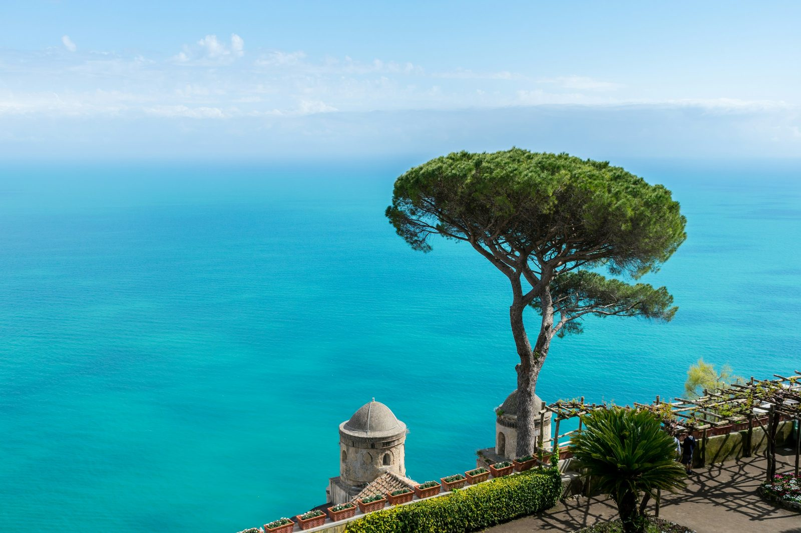
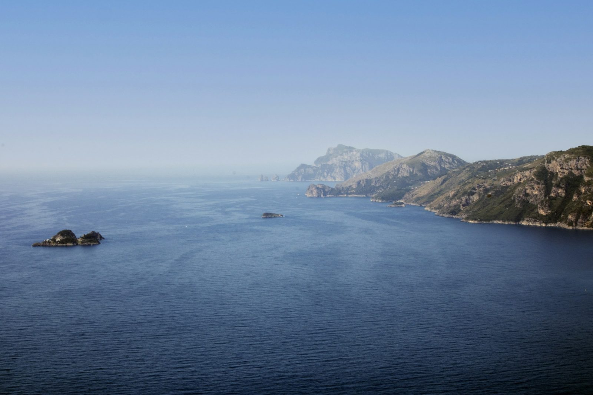
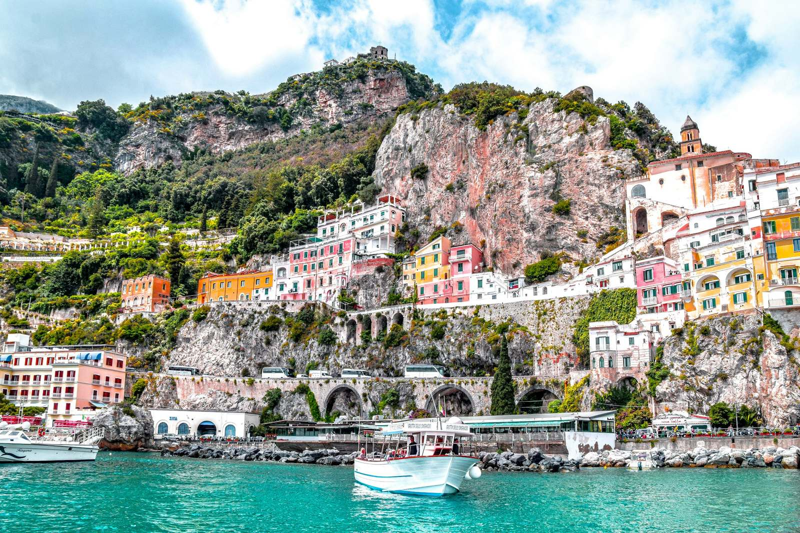

The Amalfi Coast is one of the few places where the town you choose matters as much as the hotel. The coast road is narrow and winding, the ferries run on their own schedule, and getting from one town to the next for dinner can take longer than you expect. After [fifteen years working inside luxury hotels](/about/), my advice is simple: pick your base for how you want your days to feel, then pick the hotel.

Most travelers arrive through Naples International Airport, roughly 90 minutes by car from Positano, or by high-speed train from Rome to Naples. Plan on a private transfer for the last stretch. It's the easiest way to arrive with luggage on a road like this one.

## Positano: for the postcard, and for people who want to be in it

Positano is the town on every screensaver: pastel houses stacked down the cliff to the beach, boutiques, and boats leaving for Capri. It's also vertical. Almost everything involves stairs, and that's part of the charm.

**Who it suits:** first-timers, honeymooners, and anyone who wants to walk out of the hotel and straight into the scene.

**Hotels to know:** Le Sirenuse, opened by the Sersale family in their former private villa in 1951, sits right in the center of town with 58 rooms and suites, most with views of the sea or the town. Il San Pietro di Positano is about ten minutes outside town, set into the cliffs, with its own restaurant, Zass. It suits people who want the view of Positano without the crowds of Positano.

**Ask for at check-in:** confirm whether your room faces the sea or the town, and ask the hotel to arrange porters for your luggage if you're staying up the hill. Hotels here handle this every day, and it saves you carrying cases up a staircase.

## Ravello: for quiet, views and long dinners

Ravello sits high above the sea, away from the beach crowds, with gardens at Villa Rufolo and Villa Cimbrone and a long-running summer music festival.

**Who it suits:** couples, second visits, and travelers who'd rather look at the water than swim in it every day.

**Hotels to know:** Caruso, A Belmond Hotel, is a former 11th-century palace known for its infinity pool over the coast. Palazzo Avino is a 12th-century palazzo with its own fine-dining restaurant, Rossellinis.

**Ask for at check-in:** the hotel's shuttle or transfer options down to the coast. Ravello is a drive above the sea, and knowing how to get down for a beach day or a boat makes the stay much easier.

## Praiano and Conca dei Marini: for a true escape

Between Positano and Amalfi, these smaller places are quieter, with fewer day-trippers and big views in both directions.

**Who it suits:** travelers who want to rest, design lovers, and anyone happy to take a boat or car into town for dinner.

**Hotels to know:** Casa Angelina in Praiano is contemporary and bright, with floor-to-ceiling windows on the sea. Borgo Santandrea, near Amalfi, is one of the newer luxury openings on the coast and is built down the cliff to the water.

**Ask for at check-in:** dinner reservations for your first night at the hotel itself. In the quieter towns, the hotel restaurant is often the best table nearby, and arrival day is not the night to figure out transport.

## Amalfi town: for convenience and connections

Amalfi is the ferry hub, with the cathedral, the piazza and easy boat connections up and down the coast.

**Who it suits:** travelers who want to see several towns without a car, and anyone who likes some bustle outside the door.

**Hotels to know:** Hotel Santa Caterina, just outside the center, has terraced gardens above the sea and an elevator down to its own swimming area.

## Sorrento: for easier logistics

Sorrento technically sits on the peninsula just beyond the Amalfi Coast, but it's a popular base for good reason: train connections toward Naples, ferries to Capri, and a flatter town that's easier to walk. It suits families, longer stays and travelers combining the coast with Pompeii.

## When to Go

May, June and September into early October are the sweet spot: warm water, long days, and fewer crowds than July and August, which are the busiest months and the most expensive. Many of the coast's best hotels close for the winter, often from around November until spring, so check opening dates before you set your heart on a property. Ferries also run a reduced schedule outside the main season.

## What to ask for at check-in, from someone who stood behind the desk

- **Confirm the view category before you unpack.** On this coast, sea view, partial sea view and garden view are priced very differently. If something doesn't match your booking, the front desk can fix it in minutes.
- **Mention the occasion.** Honeymoons and anniversaries are a big part of the coast's business, and a note on the reservation is how a bottle or a better table happens.
- **Ask about the hotel's boat, beach and shuttle.** Many top hotels run their own, and the best slots go to guests who ask first.
- **Book the hotel's restaurant on arrival** for at least one night, especially in high season.
- **Ask for late checkout when you arrive,** not on your last morning.

## How Booking with an Advisor Works Here

When you book through me, you pay the same room rate you'd pay booking direct, and you get partner perks on top. As a Fora advisor, I can attach those perks at every hotel named above. Fora's public pages currently list breakfast daily, a $100 credit, and an upgrade and extended check-in and checkout whenever possible at Le Sirenuse, Il San Pietro di Positano, Caruso, Casa Angelina, Palazzo Avino, Hotel Santa Caterina and Borgo Santandrea. The credit is a hotel or resort credit at some and a food and beverage credit at others. Upgrades, early check-in and late checkout are always subject to availability, and perks can change, so I confirm what applies to your dates before you book.

[Hotel-only bookings](/services/#pricing) with me are complimentary. If you're pairing the coast with Rome, or want flights, transfers and restaurants planned day by day, that's a flat planning fee, listed on my [Services page](/services/#pricing).

## Start Here

Tell me who's going, when, and whether you picture yourself in the middle of Positano or high above it in Ravello. I'll come back with the right town, the right hotel and the right room. The first step is a short intake that sets up your traveler profile: [start your trip](https://secure.foratravel.com/intake/wyldwandering/C8ug7ybur3).

---

*Photos: [Letizia Agosta](https://unsplash.com/photos/village-near-the-ocean-3TzHmifXX5k) / Unsplash, [Kevin McMahon](https://unsplash.com/photos/green-tree-near-body-of-water-during-daytime--naFVsXYuTg) / Unsplash, [Pasquale Fusco](https://unsplash.com/photos/a-large-body-of-water-surrounded-by-mountains-LAVmstFtw0Y) / Unsplash, [Tom Podmore](https://unsplash.com/photos/colorful-buildings-on-amalfi-cliffside-1zkHXas1GIo) / Unsplash*
