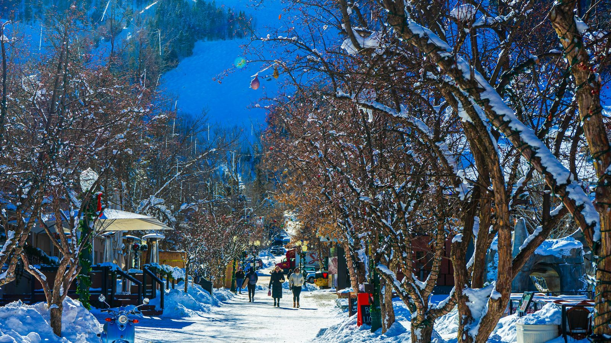
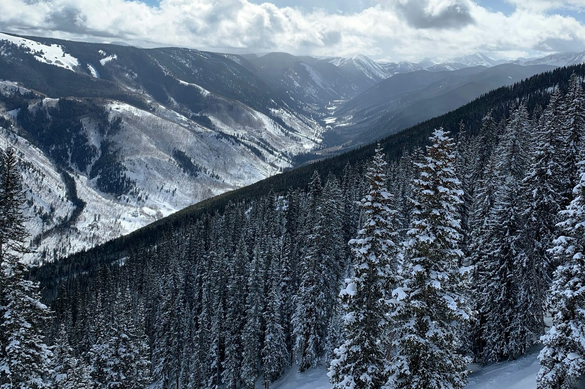
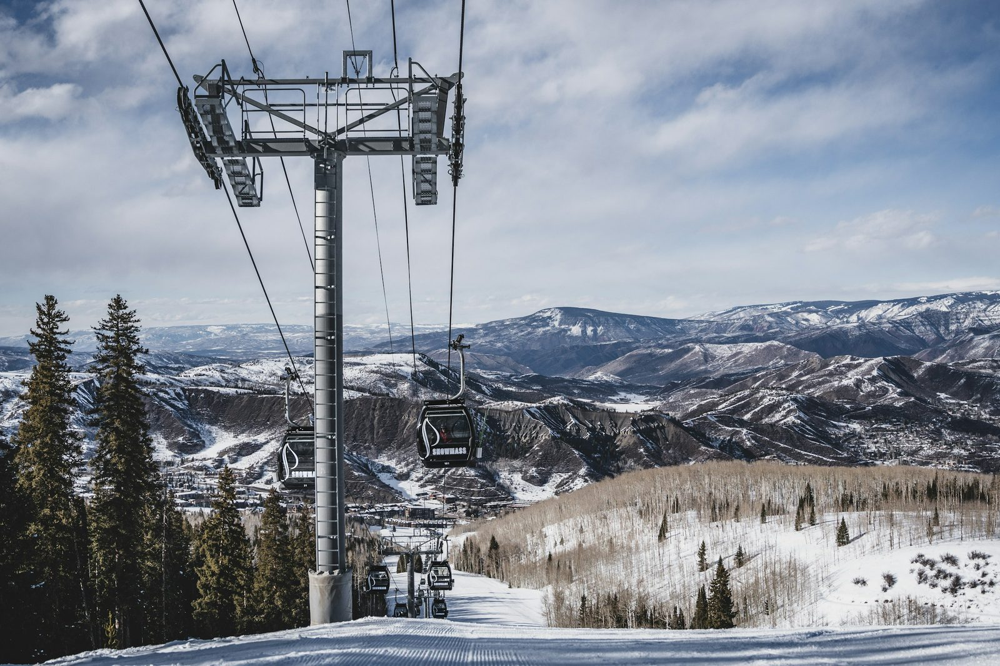

Aspen Snowmass is four mountains on one lift ticket, but where you sleep decides the trip: a historic hotel in a walkable town, a room you can ski back to at the base of Aspen Mountain, or a family base in Snowmass Village with more terrain out the door. After [fifteen years working inside luxury hotels](/about/), my advice is simple: decide what kind of Aspen you want, choose the area, then choose the hotel.

Getting there is easier than most people expect. Aspen/Pitkin County Airport (ASE) is about three miles from town and six from Snowmass Village. This winter it has nonstop flights from Atlanta, Austin, Charlotte, Chicago O'Hare, Dallas/Fort Worth, Denver, Houston, Los Angeles, Phoenix and San Francisco, though several of those routes only start in December. Here's how three of the best places to stay compare.

## Downtown Aspen: For Walking to Dinner and Historic Hotels

Downtown Aspen is a compact grid of restaurants, boutiques and bars at the foot of Aspen Mountain. Stay here and you'll walk almost everywhere, and the town's free buses cover the rest.

**Who it suits:** couples, food lovers, first-timers, and anyone who cares as much about the evenings as the ski days.

**Hotels to know:** Hotel Jerome, part of the Auberge Collection, opened in 1889 at the height of Aspen's silver boom and is on the National Register of Historic Places. It has 93 guest rooms and suites, holds one Michelin Key, and its J-Bar is what the hotel calls Aspen's favorite watering hole. The hotel runs a complimentary shuttle to all four ski mountains and picks guests up at the airport.

**Ask for at check-in:** the shuttle schedule for the next morning, so you're on the first run instead of waiting at the curb.

## Aspen Mountain's Base: For Ski-In, Ski-Out in Town

The base of Aspen Mountain, which locals call Ajax, is where town meets the lifts. You get downtown's restaurants a few blocks away and the Silver Queen Gondola at the bottom of town. This season the mountain also adds the Nell Bell, a new high-speed quad that replaces two older lifts.

**Who it suits:** strong skiers, short trips where every hour on the mountain counts, and travelers who want to walk to the lift and to dinner.

**Hotels to know:** The Little Nell sits steps from the Silver Queen Gondola and is Aspen's only ski-in, ski-out hotel with Forbes Five-Star and AAA Five Diamond ratings. It has 92 rooms and suites, every room has a gas fireplace, and its wine cellar has won Wine Spectator's Grand Award. The St. Regis Aspen Resort, also at the base of Aspen Mountain, has 154 rooms and 25 suites, a heated outdoor pool and hot tubs facing the mountain, the RAKxa Wellness Spa, and St. Regis Butler Service for suite guests. Its bar sabers champagne daily, a St. Regis tradition.

**Ask for at check-in:** at The Little Nell, whether your room is Town Side or Mountain Side. They're very different views, so confirm the one you booked.

## Snowmass Village: For Families and More Terrain

Snowmass Village is a separate resort town down the valley from Aspen, built around the Snowmass ski area and its more than 3,000 acres of terrain. Free buses run between the two. Base Village has a free ice rink (free skates too), restaurants and lodging at the lifts, and the Treehouse Kids' Adventure Center offers childcare for young children.

**Who it suits:** families, multigenerational groups, mixed-ability skiers, and longer stays where space matters more than nightlife.

**Hotels to know:** Viceroy Snowmass calls itself the only ski-in, ski-out luxury resort in Snowmass. Its accommodations are suites and residences, and it has a 7,000-square-foot spa designed by Jean-Michel Gathy, an outdoor pool, and Toro Snowmass among its restaurants. Limelight Snowmass sits at the base of the Elk Camp Gondola, also ski-in, ski-out, with breakfast included in every stay, a five-story indoor climbing wall, a kids' room and a hotel shuttle to and from the airport.

**Ask for at check-in:** connecting rooms or a residence layout if you're traveling as a family. Request it when you book, then confirm it on arrival.

## When to Go

Aspen Mountain and Snowmass are scheduled to open on Thanksgiving Day, November 26, 2026, and Aspen Highlands and Buttermilk follow on December 12. Aspen Mountain is scheduled to run until April 18, 2027, and Snowmass until April 11. All of it depends on snow, as every opening does. This is also Aspen Snowmass's 80th season. Late November to mid-December is the quieter window before the holiday rush, and peak dates book best 6 to 12 months out.

One date matters for spring trips: Aspen/Pitkin County Airport is scheduled to close from April 4 to November 19, 2027, for runway reconstruction. After April 4, plan on flying into Eagle County Airport, about 70 miles from Aspen, or Denver. If your dates are flexible, ask me to look at them before you commit.

## What to Ask for at Check-In, From Someone Who Stood Behind the Desk

- **Confirm your room category and view before you go upstairs.** Rooms on the same floor can face town or the mountain, so make sure you have the one you booked.
- **Ask about arrival timing.** Check-in is often 4 PM (The St. Regis Aspen, for example). Ask about early check-in or holding your bags and skis, and request late checkout when you arrive, not on your last morning. Both are subject to availability.
- **Mention the occasion.** Anniversaries and birthdays get noted on the reservation, and a note is how small touches happen.
- **Book ski school, rentals and the big dinners before you fly.** Holiday weeks fill early.
- **Ask the concierge what's open right now.** Lifts, terrain and restaurant hours change through the season, and that's where local knowledge pays off.

## How Booking With an Advisor Works Here

When you book through me, you pay the same room rate you'd pay booking direct, and I can add partner perks at many of the hotels above, typically breakfast, a hotel or dining credit, and an upgrade when available. Perks depend on each hotel's program, and upgrades, early check-in and late checkout are always subject to availability, so I confirm exactly what applies to your dates before you book.

[Hotel-only bookings](/services/#pricing) with me are complimentary. If you want flights handled too, or a full itinerary with ski school, restaurants and day-by-day plans, that's a flat planning fee, listed on my [Services page](/services/#pricing).

## Start Here

Tell me who's going, when, and whether you picture yourself walking to dinner downtown, clicking into your skis outside The Little Nell or watching the kids at the Base Village rink. I'll come back with the right area, the right hotel and the right room. The first step is a short intake form: [start your trip](https://intake.wyldwandering.com).

---

*Photos: [Derek Baumgartner](https://unsplash.com/photos/JGTlSNMQHOo) / Unsplash, [mitchell bath](https://unsplash.com/photos/DntB6t8r3f4) / Unsplash, [Bea de Ros](https://unsplash.com/photos/tqvWKa4tZ_A) / Unsplash, [Chase Baker](https://unsplash.com/photos/7k2C3Ad7bFU) / Unsplash*
