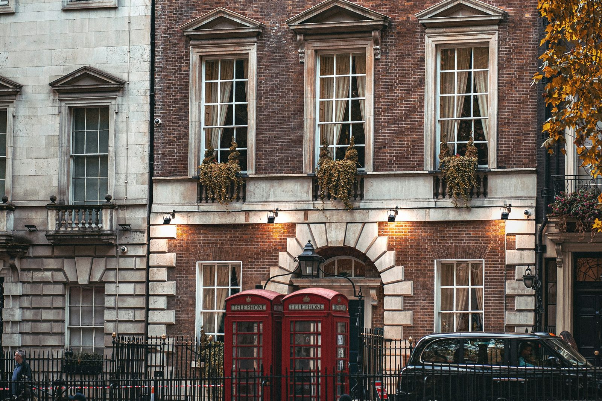
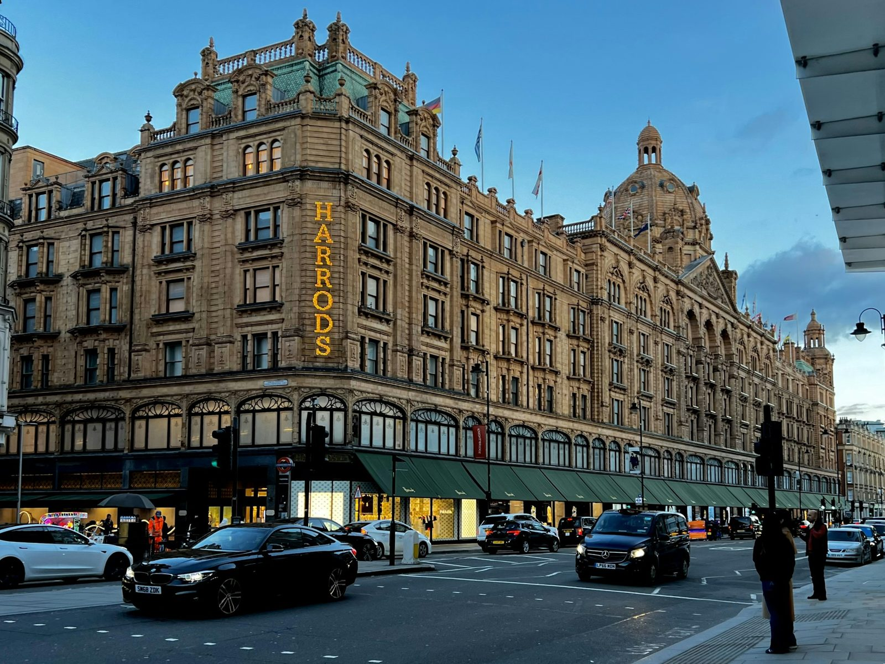
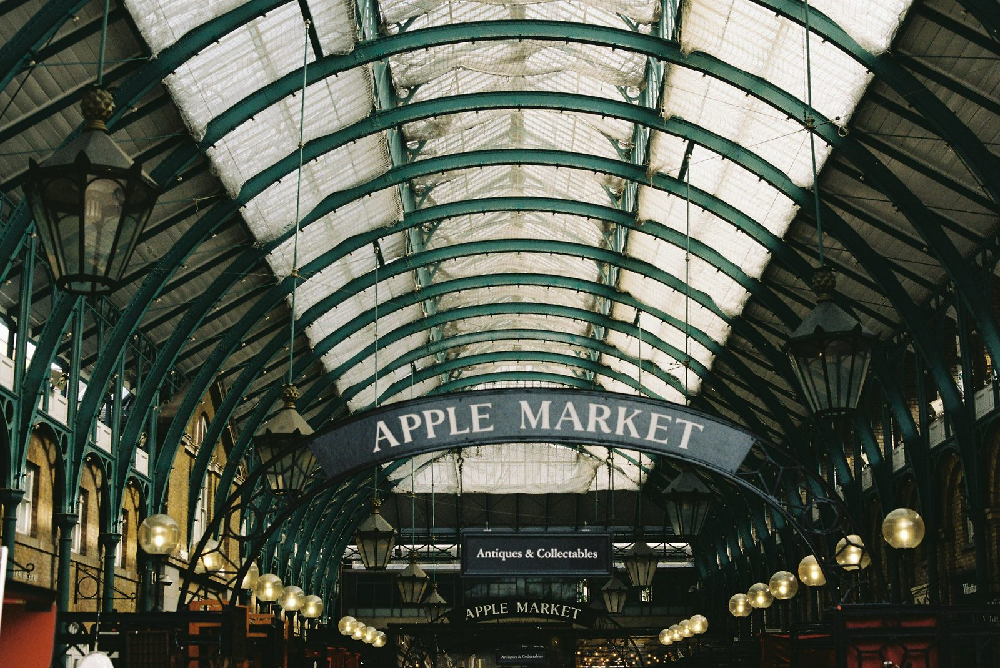

London rewards the traveler who picks a neighborhood first. The city is big, and a hotel in Mayfair, Knightsbridge, Marylebone or Covent Garden can make it feel like four different trips: a quiet street at night, a morning beside the park, an afternoon in the boutiques or an evening at the theater. After [fifteen years working inside luxury hotels](/about/), my advice is simple: decide what kind of London you want, choose the neighborhood, then choose the hotel.

From Heathrow, allow roughly 50 minutes by car to the Strand, or up to an hour on the Piccadilly line to Hyde Park Corner. US travelers usually need a UK electronic travel authorisation (ETA) rather than a visa for a tourist stay, and every traveler needs one, children included. Apply only through the official GOV.UK site or the UK ETA app. Here's how four of London's best hotel neighborhoods compare.

## Mayfair: For Grand Hotels and Quiet Luxury

Mayfair is classic London: designer flagship stores, tree-lined streets and historic hotels, with Soho and the West End theaters a short walk away.

**Who it suits:** first-timers, honeymooners, shoppers, and anyone who wants a polished neighborhood with quiet streets.

**Hotels to know:** Claridge's, on Brook Street, was founded in 1812 and describes its rooms as spanning Victorian, Art Deco and contemporary styles. Brown's Hotel, on Albemarle Street, opened in 1837 and now fills eleven Georgian townhouses, with afternoon tea in its Drawing Room.

**Ask for at check-in:** which style of room you've been given. At a hotel with that much range, it's worth knowing before you go upstairs.

## Knightsbridge: For Hyde Park, Harrods and Museums

Knightsbridge puts you beside Hyde Park, with luxury boutiques and world-class museums nearby. It's polished and fashionable, an easy base for shopping by day and a walk in the park before dinner.

**Who it suits:** shoppers, couples, families who want a park next door, and travelers who value attentive service.

**Hotels to know:** The Lanesborough, at Hyde Park Corner next to the Tube station, has 93 rooms and suites, and says it's the only hotel in London with round-the-clock dedicated butler service in every room and suite. The Berkeley sits between Belgravia, Knightsbridge and Hyde Park, and is home to pastry chef Cedric Grolet's counter.

**Ask for at check-in:** your view category. The Lanesborough lists Park View rooms overlooking Hyde Park or Wellington Arch, while some categories look onto a courtyard or Belgravia instead. Confirm which you booked.

## Marylebone: For a Village Feel Near Oxford Street

Marylebone is an upscale residential neighborhood of boutiques and restaurants, with Oxford Street, Bond Street and Mayfair close by.

**Who it suits:** return visitors, couples, and travelers who want a neighborhood feel with Soho and Mayfair within easy reach.

**Hotels to know:** The Marylebone, at 47 Welbeck Street in Marylebone Village, includes complimentary access to its on-site Third Space health club. The Prince Akatoki, on Great Cumberland Place near Marble Arch, opened in 2019 with 82 rooms and suites in a Japanese-inspired design.

## Covent Garden and the Strand: For Theater and the West End

This is London at its busiest: theaters, the market, restaurants and bars, all within walking distance.

**Who it suits:** first-timers, theater lovers, and anyone who wants to be in the middle of it and doesn't need a quiet street.

**Hotels to know:** Covent Garden Hotel, at 10 Monmouth Street in Seven Dials, has 58 rooms with interiors by Kit Kemp, close to the Royal Opera House and Covent Garden Piazza. The Savoy, on the Strand beside the Thames, reopened in 2010 after a £220 million refit. Charing Cross station is a four-minute walk, and the Covent Garden and Embankment stations are six.

## When to Go

London works all year. Spring, from March to May, brings blooming parks and comfortable temperatures. Summer, from June to August, is peak season, with the biggest crowds and a packed calendar of festivals. Autumn, from September to November, is cooler and quieter, good for museums. Winter, from December to February, is crisp and festive, with holiday lights, Christmas markets and fewer lines at major sights. Whenever you go, book popular restaurants, shows and top attractions ahead, especially in peak season. If your dates are flexible, ask me to look at them before you commit.

## What to Ask for at Check-In, From Someone Who Stood Behind the Desk

- **Confirm your room category and view before you go upstairs.** At many London hotels, rooms vary in style and view even within one building, so make sure you have the one you booked.
- **Ask about arrival timing.** Check-in is often mid-afternoon (the Prince Akatoki, for example, checks in from 3 PM and out at 12 PM), and many flights from the US land in the morning. Ask about early check-in or holding your bags, and request late checkout when you arrive, not on your last morning. Both are subject to availability.
- **Mention the occasion.** Anniversaries and birthdays get noted on the reservation, and a note is how small touches happen.
- **Book afternoon tea, dinners and shows before you fly.** The best tables and seats go early.
- **Ask the concierge what's good right now.** London's dining scene changes quickly, and that's where the hotel's local knowledge pays off.

## How Booking With an Advisor Works Here

When you book through me, you pay the same room rate you'd pay booking direct, and you get partner perks on top. As a Fora advisor, I can attach perks at most of the hotels above. Fora's public pages currently list breakfast daily and an upgrade and extended check-in and checkout whenever possible at Claridge's, Brown's Hotel, The Lanesborough and The Berkeley, each with a $100 food and beverage credit (food and beverage or spa at The Lanesborough). The Marylebone lists a £85 food and beverage credit, a welcome gift, a full breakfast for two (or up to £35) and an upgrade and extended check-in and checkout whenever possible. The Prince Akatoki lists a $100 food and beverage credit, welcome amenities, breakfast daily and extended check-in and checkout whenever possible. Covent Garden Hotel lists a welcome amenity, breakfast daily and an upgrade and extended check-in and checkout whenever possible. At The Savoy, I confirm the current perks for your dates. Upgrades, early check-in and late checkout are always subject to availability, and perks can change, so I confirm what applies to your dates before you book.

[Hotel-only bookings](/services/#pricing) with me are complimentary. If you want flights handled too, or a full itinerary with restaurants, shows and day-by-day plans, that's a flat planning fee, listed on my [Services page](/services/#pricing).

## Start Here

Tell me who's going, when, and whether you picture yourself on a quiet Mayfair street, beside Hyde Park in Knightsbridge, or in the middle of the West End. I'll come back with the right neighborhood, the right hotel and the right room. The first step is a short intake that sets up your traveler profile: [start your trip](https://secure.foratravel.com/intake/wyldwandering/C8ug7ybur3).

---

*Photos: [Jacob Diehl](https://unsplash.com/photos/the-big-ben-clock-tower-towering-over-the-city-of-london-d80dS3gesa8) / Unsplash, [Anthony](https://unsplash.com/photos/zjBxPUHE_ok) / Unsplash, [Godefroy Le Guisquet](https://unsplash.com/photos/a-very-tall-building-sitting-on-the-side-of-a-road-X8x7r-glI_s) / Unsplash, [T](https://unsplash.com/photos/interior-of-apple-market-with-arched-ceiling-Y979GW-X_ts) / Unsplash*
