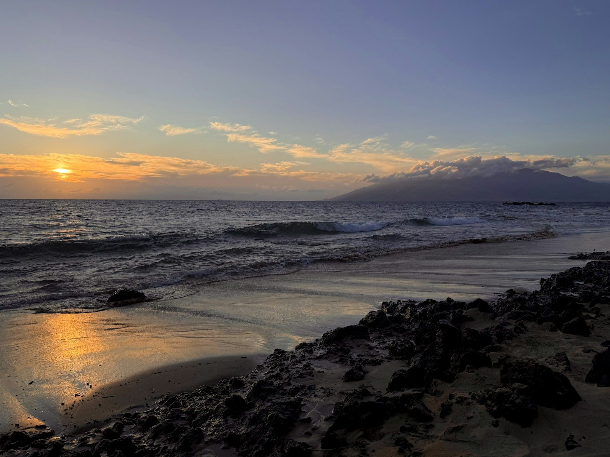
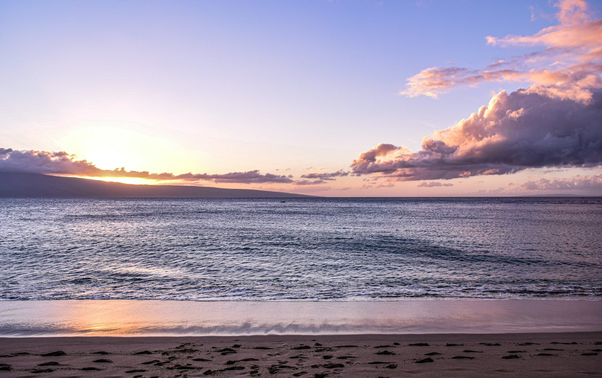
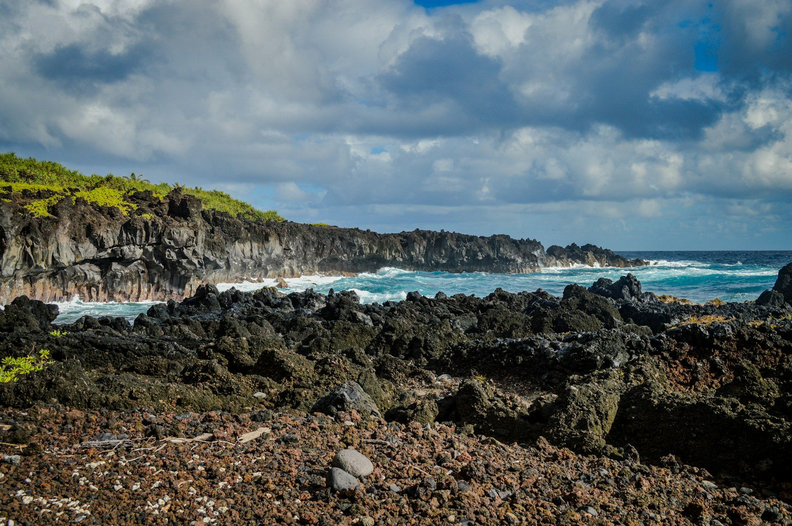

Maui is one island, but where you sleep decides the trip: a polished beach walk in Wailea, a quiet bay in Kapalua, a lively three-mile beach in Kāʻanapali or a rainforest town in Hāna. After [fifteen years working inside luxury hotels](/about/), my advice is simple: decide what kind of Maui you want, choose the area, then choose the hotel.

Most travelers from the mainland fly into Kahului Airport (OGG). From there, allow about 25 to 30 minutes by car to Wailea, about 50 minutes to Kāʻanapali and about an hour to Kapalua. Hawaiʻi doesn't observe daylight saving time, so from November to March it runs two hours behind the West Coast, and three hours behind in summer. Here's how four of Maui's best places to stay compare.

If you'd like me to book the hotel, [hotel-only bookings are complimentary](/services/#pricing), and I can add Fora perks at most of the hotels in this guide: breakfast, a resort or dining credit, and an upgrade when available.

## Wailea: For Sunny Beaches and Polished Resorts

Wailea is South Maui's resort community: crescent beaches, three championship golf courses and The Shops at Wailea, with a beachfront path that links the resorts.

**Who it suits:** first-timers, honeymooners, families, and anyone who wants to walk from the pool to dinner.

**Hotels to know:** Four Seasons Resort Maui at Wailea overlooks Wailea Beach and has reimagined nearly everything, from its rooms and pools to a new Spa and Wellness Centre. Fairmont Kea Lani, on Polo Beach, calls itself Hawaiʻi's only all-suite and villa luxury resort: 413 one-bedroom suites and 37 two-story villas, each villa with a full kitchen and a courtyard plunge pool. Hotel Wailea, Hawaiʻi's only Relais & Châteaux hotel, has 72 suites on 15 acres and is adults-only, 18 and older.

**Ask for at check-in:** your view. Fairmont Kea Lani's one-bedroom suites face either the gardens and pools or the ocean, so confirm which you booked.

## Kapalua: For a Quieter, Greener West Maui

Kapalua sits in northwest Maui at the foot of the West Maui Mountains, with five bays and three white-sand beaches. It's quieter, greener and more spread out than Wailea.

**Who it suits:** return visitors, golfers, couples, and families who want space and nature over a scene.

**Hotels to know:** The Ritz-Carlton Maui, Kapalua is set on 54 acres within the larger Kapalua Resort, with 107 residential suites and Jean-Michel Cousteau's Ambassadors of the Environment naturalist program. The Resort at Kapalua Bay, formerly Montage Kapalua Bay, has 146 multi-bedroom, ocean-view residences. Marriott took over management in March 2026, and the resort is slated to join St. Regis in 2027 after a renovation.

**Ask for at check-in:** at The Resort at Kapalua Bay, what renovation work is scheduled during your stay, and which residences are farthest from it.

## Kāʻanapali: For a Lively Beach and Big Family Resorts

Kāʻanapali has three miles of white sand, Hawaiʻi's first planned resort, and Whalers Village for shops and restaurants. Every evening at sunset, a cliff diver lights the torches on Puʻu Kekaʻa, known as Black Rock, and dives into the sea. Lahaina town, just to the south, is rebuilding after the August 2023 wildfire. Front Street reopened to traffic in August 2026, and residents ask visitors to drive through mindfully.

**Who it suits:** families, groups, and travelers who want an easy, social beach day.

**Hotels to know:** Hyatt Regency Maui Resort & Spa sits on 40 oceanfront acres along Kāʻanapali Beach, with 810 rooms and suites, a half-acre pool with a 150-foot lava tube waterslide, and a rooftop astronomy program, Tour of the Stars.

## Hāna: For Rainforest, Waterfalls and Unplugging

Hāna is a quiet town on Maui's eastern shore, at the end of the Hāna Highway. It's only 52 miles from Kahului, but 620 curves and 59 bridges, many of them one lane, make it a two-to-four-hour drive.

**Who it suits:** couples, nature lovers, and anyone who wants Maui at its slowest.

**Hotels to know:** Hāna-Maui Resort, part of the Destination by Hyatt collection, has oceanfront bungalows and garden suites, and there are no TVs or clocks in the rooms (only the villas have a TV). A resort shuttle runs to Hāmoa Beach. If you'd rather skip the drive, small planes connect Kahului to Hāna Airport, four miles from the resort.

**Ask for at check-in:** help with Waiʻānapanapa State Park, the black sand beach nearby, which needs an advance reservation.

## When to Go

Maui works all year, but winter has a headliner: humpback whales. NOAA says they're usually in Hawaiian waters from November through May, peaking from January through March. It's illegal to approach within 100 yards, so go with a responsible tour. Peak dates book best 6 to 12 months out. If you're driving to Hāna, the resort suggests leaving around 6 to 7 AM to beat the crowds. If your dates are flexible, ask me to look at them before you commit.

## What to Ask for at Check-In, From Someone Who Stood Behind the Desk

- **Confirm your room category and view before you go upstairs.** Garden, partial ocean and oceanfront rooms can sit in the same building, so make sure you have the one you booked.
- **Ask about arrival timing.** Check-in is often 4 PM (Hyatt Regency Maui and Hāna-Maui Resort, for example). Ask about early check-in or holding your bags, and request late checkout when you arrive, not on your last morning. Both are subject to availability.
- **Mention the occasion.** Anniversaries and birthdays get noted on the reservation, and a note is how small touches happen.
- **Book the luau, the big dinners and the boat trips before you fly.** The best seats and sailings go early.
- **Ask the concierge what's open right now.** Roads, parks and reservations change, and that's where local knowledge pays off.

## How Booking With an Advisor Works Here

When you book through me, you pay the same room rate you'd pay booking direct, and you get partner perks on top. As a Fora advisor, I can attach perks at most of the hotels above. At Four Seasons Resort Maui, Fora bookings get Four Seasons Preferred Partner amenities, which I'll walk you through. Fora's public pages currently list a $100 credit, breakfast daily and an upgrade and extended check-in and checkout whenever possible at Fairmont Kea Lani and The Ritz-Carlton Maui, Kapalua. Hyatt Regency Maui and Hāna-Maui Resort each list a hotel credit, a welcome amenity, breakfast daily and an upgrade and extended check-in and checkout whenever possible. Hotel Wailea lists a $25 food and beverage credit, a welcome amenity and an upgrade and extended check-in and checkout whenever possible. At The Resort at Kapalua Bay, I confirm the current perks for your dates. Upgrades, early check-in and late checkout are always subject to availability, and perks can change, so I confirm what applies to your dates before you book.

[Hotel-only bookings](/services/#pricing) with me are complimentary. If you want flights handled too, or a full itinerary with restaurants, tours and day-by-day plans, that's a flat planning fee, listed on my [Services page](/services/#pricing).

## Start Here

Book through me and get Fora perks — breakfast, a resort or dining credit, and an upgrade when available — at no extra cost on a [hotel-only booking](/services/#pricing). Tell me who's going, when, and whether you picture yourself on the Wailea beach path, on a quiet Kapalua bay, on the sand at Kāʻanapali or somewhere past the last bridge in Hāna. I'll come back with the right area, the right hotel and the right room. The first step is a short intake that sets up your traveler profile: [start your trip](https://secure.foratravel.com/intake/wyldwandering/C8ug7ybur3).

---

*Photos: [Richard de Vries](https://unsplash.com/photos/XovV5tLjP4s) / Unsplash, [Matthew Kosloski](https://unsplash.com/photos/3LtT9wQKz9E) / Unsplash, [Engin Yapici](https://unsplash.com/photos/YQqdkjtLiq0) / Unsplash, [Tyke Jones](https://unsplash.com/photos/cDlQ0CBhD3Y) / Unsplash*
