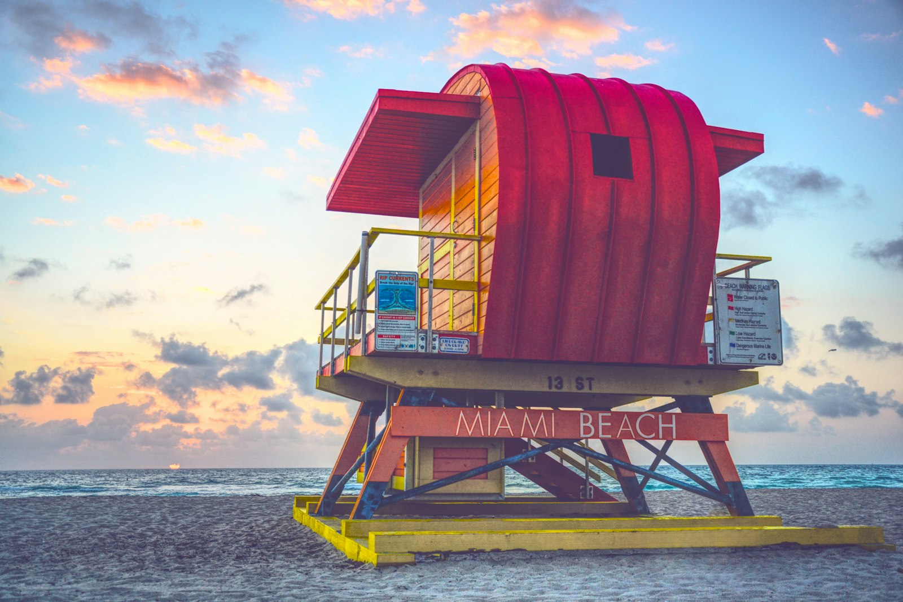
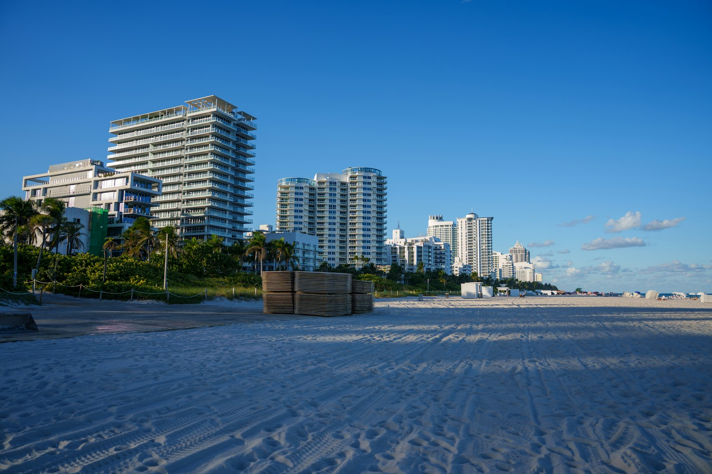
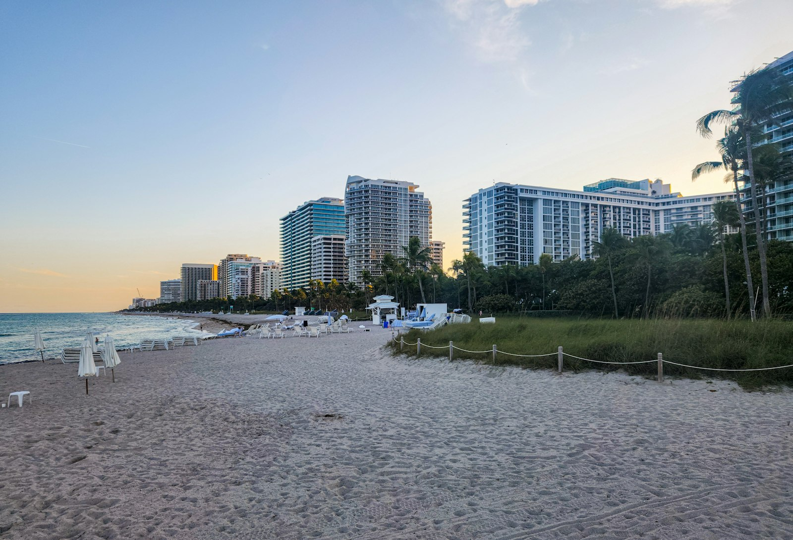

Most people say Miami and mean the beach, and the beach is a long one. Miami Beach and the towns north of it run for miles along Collins Avenue, and the trip changes a lot depending on where you sleep: Art Deco blocks and late dinners in South Beach, big statement hotels in Mid-Beach, or a quieter, more residential stretch in Surfside and Bal Harbour. After [fifteen years working inside luxury hotels](/about/), my advice is simple: decide what kind of Miami you want, choose the area, then choose the hotel.

Getting there is the easy part. Miami International (MIA) is an American Airlines hub, and this month it has nonstops from New York (JFK, LaGuardia and Newark), Boston, Washington, Atlanta, Chicago, Dallas/Fort Worth, Houston, Denver, Phoenix, Los Angeles, San Francisco and Seattle. That makes it one of the simplest long weekends in the country. Here's how three of the best places to stay compare.

## South Beach: For Art Deco, Restaurants and Being in the Middle of It

South Beach is the southern end of Miami Beach and the part most people picture: the Art Deco district, the painted lifeguard towers, Ocean Drive and Collins Avenue, and more restaurants and bars than you'll get to in a week. Stay here and you can walk to dinner most nights.

**Who it suits:** couples, first-timers, groups of friends, and anyone who wants the city's energy outside the front door.

**Hotels to know:** The Setai, Miami Beach, at 2001 Collins Avenue, combines a restored 1936 Art Deco building with an oceanfront glass tower. Its three pools are each kept at a different temperature (75, 85 and 90 degrees), it has a Valmont spa, a Les Clefs d'Or concierge team, and full beach service on daybeds. Forbes Travel Guide rates it Five-Star for 2026.

**Ask for at check-in:** confirm whether you're in the Art Deco building or the Ocean Suites tower. They're different experiences, so make sure you have the one you booked.

## Mid-Beach: For Statement Hotels and a Little More Space

Mid-Beach runs north of South Beach along Collins Avenue. The beach is just as good, the pace is a notch calmer, and it's home to some of Miami's most talked-about hotels. You're a short ride from South Beach restaurants without sleeping in the middle of them.

**Who it suits:** design lovers, spa weekends, celebrations, and travelers who want the hotel itself to be part of the trip.

**Hotels to know:** Faena Hotel Miami Beach, at 3201 Collins Avenue, anchors the Faena District and is rated Forbes Five-Star for 2026. Its 22,000-square-foot Tierra Santa Healing House spa takes up the hotel's third floor, Los Fuegos by Francis Mallmann cooks over open fire, and the Faena Theater stages shows on property. A few blocks south, The Miami Beach EDITION, at 2901 Collins Avenue, has two outdoor pools and a basement with a bowling alley and an ice-skating rink. Forbes rates it Four-Star.

**Ask for at check-in:** at Faena, which way your room faces. Categories range from bay view to partial ocean view to oceanfront, so confirm the view you paid for before you go upstairs.

## Surfside and Bal Harbour: For Quiet Beaches and Families

Surfside and Bal Harbour are separate small towns north of Miami Beach, and they feel it: fewer crowds, wider stretches of sand, and evenings that end earlier. Bal Harbour Shops sits on Collins Avenue, across the street from the beach.

**Who it suits:** families, multigenerational trips, repeat Miami visitors, and anyone who wants a resort feel without leaving the city.

**Hotels to know:** Four Seasons Hotel at The Surf Club, at 9011 Collins Avenue in Surfside, is built around the original Surf Club, which opened on New Year's Eve 1930. Richard Meier designed the new buildings that frame the old clubhouse, and Joseph Dirand designed the interiors. It has 77 guest rooms plus four ocean bungalows and suites, a family pool and an adults-only quiet pool, a supervised Kids for All Seasons club, and Lido, an Italian restaurant in the club's original ballroom. The St. Regis Bal Harbour Resort, across Collins Avenue from Bal Harbour Shops, has 211 rooms and suites, each with floor-to-ceiling windows and a glass-walled balcony, and St. Regis Butler Service for suite guests. Forbes rates both hotels Five-Star for 2026.

**Ask for at check-in:** at The Surf Club, whether your room faces the ocean or the courtyard. The entry-level Surf Club Room looks over the grounds, so if a sea view matters, book the category that guarantees it.

## When to Go

Winter is high season, when most of the country is cold and Miami isn't. Greater Miami's tourism board calls February peak season, with higher hotel and airfare prices, and April the start of shoulder season, when prices drop. One week to plan around is coming up fast: Miami Art Week runs November 30 to December 6, 2026, with Art Basel Miami Beach's public days December 4 to 6 at the Miami Beach Convention Center (VIP preview days are December 2 and 3). If you're going, book now.

Summer is hotter and less crowded, with cheaper hotels and airfare, but it falls inside Atlantic hurricane season, which runs June 1 to November 30. If you travel then, book flexible rates and look at travel insurance before you commit.

## What to Ask for at Check-In, From Someone Who Stood Behind the Desk

- **Confirm your room category and view before you go upstairs.** On the beach, ocean view, partial ocean view and city or bay view can be very different rooms on the same floor.
- **Ask about arrival timing.** Morning flights land well before check-in. Ask about early check-in or holding your bags so you can head to the pool, and request late checkout when you arrive, not on your last morning. Both are subject to availability.
- **Ask how beach service works.** Many beachfront hotels set up chairs, umbrellas or daybeds for guests. Ask what's included and how early to claim a spot.
- **Mention the occasion.** Anniversaries and birthdays get noted on the reservation, and a note is how small touches happen.
- **Book the big dinners before you fly.** Weekends and Art Week fill early.

## How Booking With an Advisor Works Here

When you book through me, you pay the same room rate you'd pay booking direct, and I can add partner perks at many of the hotels above, typically breakfast, a hotel or dining credit, and an upgrade when available. Perks depend on each hotel's program, and upgrades, early check-in and late checkout are always subject to availability, so I confirm exactly what applies to your dates before you book.

[Hotel-only bookings](/services/#pricing) with me are complimentary. If you want flights handled too, or a full itinerary with restaurants, experiences and day-by-day plans, that's a flat planning fee, listed on my [Services page](/services/#pricing).

## Start Here

Tell me who's going, when, and whether you picture yourself walking to dinner in South Beach, booking a treatment at Tierra Santa or watching the kids at the pool in Surfside. I'll come back with the right area, the right hotel and the right room. The first step is a short intake form: [start your trip](https://intake.wyldwandering.com/).

---

*Photos: [Jairo Gonzalez](https://unsplash.com/photos/hB2R47qB8yA) / Unsplash, [Steven Gerstmeyr](https://unsplash.com/photos/5gutfsMll7U) / Unsplash, [ftodne](https://unsplash.com/photos/4Wx2vUQjQ-4) / Unsplash, [Zoshua Colah](https://unsplash.com/photos/CuGMc5-bR-Q) / Unsplash*
