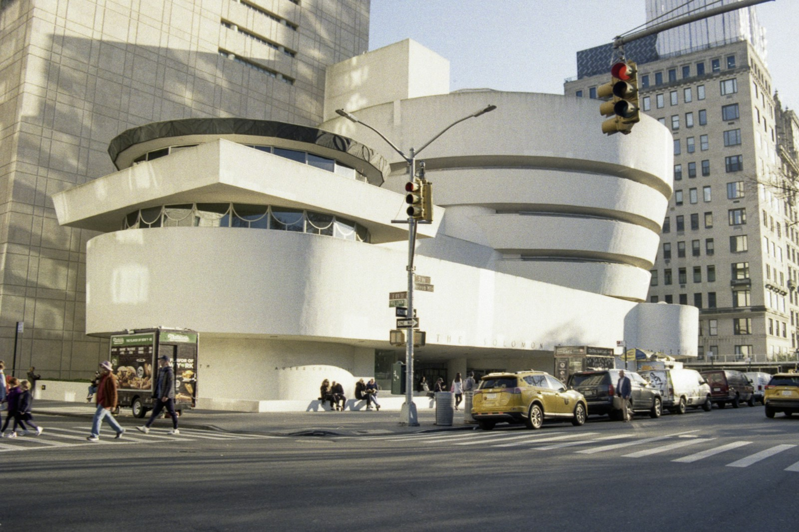
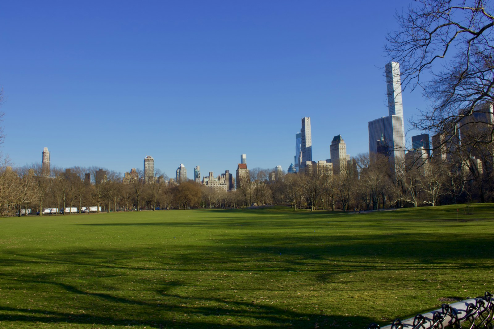
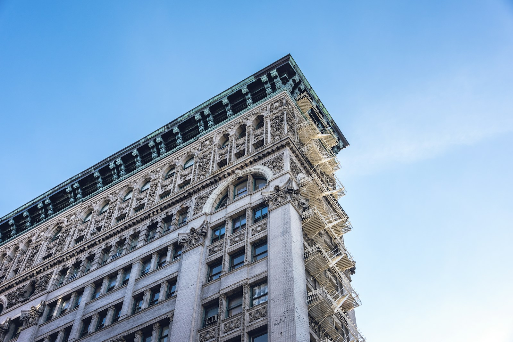

New York is the rare city where the hotel you pick can matter less than the blocks around it. The same week can feel like a quiet stay of museums and long lunches, or late dinners and gallery hopping downtown, depending on where you sleep. After [fifteen years working inside luxury hotels](/about/), my advice is the same here as everywhere: decide how you want your days to feel, choose the neighborhood, then choose the hotel.

Here's how four of Manhattan's best hotel neighborhoods compare.

## Upper East Side: For Quiet, Classic New York

Between Central Park and the East River, the Upper East Side is townhouses, Madison Avenue boutiques and the museums along Fifth Avenue, including the Met and the Guggenheim. It's residential and polished.

**Who it suits:** couples, families, museum lovers, return visitors, and anyone who wants to come home to a quiet street.

**Hotels to know:** The Carlyle, A Rosewood Hotel, sits at Madison Avenue and East 76th Street, a block from the park, and is home to Bemelmans Bar, known for nightly piano, late-night jazz and murals by Ludwig Bemelmans, and Café Carlyle, a ticketed cabaret supper club. The Mark, at Madison and 77th, was designed by Jacques Grange; rooms face Madison Avenue, East 77th Street or a townhouse garden. The Lowell, on East 63rd Street, is mostly suites, and some have wood-burning fireplaces or terraces.

**Ask for at check-in:** confirm which side of the building you're on. At The Mark, a Madison Avenue view and a garden view are different room types. At The Lowell, fireplaces and terraces come only with certain rooms, so request one when you book, not when you arrive.

## Central Park South and Fifth Avenue: For the Park View

Along the southern edge of Central Park, you're between the park and Midtown: with Fifth Avenue shopping close by and the park as your front yard.

**Who it suits:** first-timers, families, shoppers, and anyone who wants the classic New York view from the room.

**Hotels to know:** The Pierre, A Taj Hotel, is at Fifth Avenue and East 61st Street, directly across from Central Park, with Park View rooms that look out over it. The Ritz-Carlton New York, Central Park, at 50 Central Park South, has Park View and Grand Park View rooms.

**Ask for at check-in:** the view you paid for. Here, a park view, a partial park view and a city view are separate categories, and the difference is the whole point of staying on the park.

## SoHo: For Shopping, Design and Dinner Downtown

SoHo is ornate cast-iron buildings on cobblestone streets, luxury boutiques, galleries and a long list of good restaurants. It's at its busiest on weekends.

**Who it suits:** shoppers, design lovers, younger couples, and anyone who wants to walk to dinner downtown.

**Hotels to know:** The Mercer, at the corner of Mercer and Prince Streets, is intimate and discreet, with a well-known restaurant. Soho Grand, on West Broadway, has a lobby lounge and bars that fill with locals and guests at night. Crosby Street Hotel, from Firmdale Hotels, was designed by Kit Kemp.

**Ask for at check-in:** a high floor or a room away from the street. SoHo's streets are busy, and a quieter room makes a real difference to how you sleep.

## Tribeca and Lower Manhattan: For Lofts, Hotel Pools and the Hudson

Just south of SoHo, Tribeca was once a neighborhood of industrial warehouses and is now lofts and notable restaurants, with the Hudson River along its western edge. The World Trade Center sits just to its south.

**Who it suits:** families, longer stays, business trips downtown, and anyone who wants a pool in the city.

**Hotels to know:** The Greenwich Hotel, on Greenwich Street, has the Shibui Spa with a heated swimming pool. Four Seasons Hotel New York Downtown, on Barclay Street near One World Trade Center, has a 75-foot indoor lap pool for hotel guests.

## When to Go

Rates in New York follow the calendar more than the weather. September is one of the most expensive months, when New York Fashion Week and the United Nations General Assembly's high-level week fill hotels, and December is usually the priciest month of all, with the holiday season. January and February are typically the best value, and NYC Hotel Week runs in early winter with discounts at participating hotels. July is hot and humid but usually less expensive than June. If your dates are flexible, ask me to check them against the event calendar before you commit.

## What to Ask for at Check-In, From Someone Who Stood Behind the Desk

- **Confirm your room category and view before you go upstairs.** In New York, the difference between a park view, a street view and a courtyard is a price difference, so make sure you have the one you booked.
- **Ask about street noise.** A higher floor or a room off the avenue is often the quieter choice. Ask what's available.
- **Mention the occasion.** Anniversaries and birthdays get noted on the reservation, and a note is how small touches happen.
- **Ask the concierge about dinner on arrival,** not at 7 PM. The hotel can often help, but only if there's time.
- **Request late checkout when you arrive,** not on your last morning.

## How Booking With an Advisor Works Here

When you book through me, you pay the same room rate you'd pay booking direct, and you get partner perks on top. As a Fora advisor, I can attach perks at the hotels above. Fora's public pages currently list an upgrade and extended check-in and checkout whenever possible at The Carlyle, The Mark, The Lowell, The Pierre, The Ritz-Carlton New York, Central Park, The Greenwich Hotel, The Mercer and Soho Grand. The first six also list breakfast daily and a $100 credit: food and beverage at The Carlyle, The Mark, The Lowell and The Pierre, food and beverage or spa at the Ritz-Carlton, and a hotel credit at The Greenwich. The Mercer lists a $30 daily breakfast credit per person, a hotel credit and a welcome amenity, and Soho Grand lists breakfast daily, a $50 food and beverage credit and a waived amenity fee. Four Seasons Hotel New York Downtown comes with Four Seasons Preferred Partner benefits. Upgrades, early check-in and late checkout are always subject to availability, and perks can change, so I confirm what applies to your dates before you book.

[Hotel-only bookings](/services/#pricing) with me are complimentary. If you want flights handled too, or a full itinerary with restaurants, shows and day-by-day plans, that's a flat planning fee, listed on my [Services page](/services/#pricing).

## Start Here

Tell me who's going, when, and whether you picture yourself on a quiet street uptown or in the middle of things downtown. I'll come back with the right neighborhood, the right hotel and the right room. The first step is a short intake that sets up your traveler profile: [start your trip](https://secure.foratravel.com/intake/wyldwandering/C8ug7ybur3).

---

*Photos: [Jermaine Ee](https://unsplash.com/photos/new-york-central-park-A2CChTZvzTE) / Unsplash, [Ansaf A](https://unsplash.com/photos/the-solomon-r-guggenheim-museum-in-new-york-city-jLdnkeqtA04) / Unsplash, [Sri A](https://unsplash.com/photos/a-grassy-field-in-a-park-with-a-city-skyline-in-the-background-ADrZTuByhfM) / Unsplash, [Paulo Evangelista](https://unsplash.com/photos/YLtkl0Vgd7g) / Unsplash*
