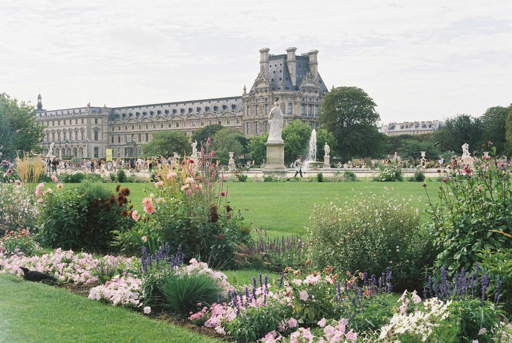
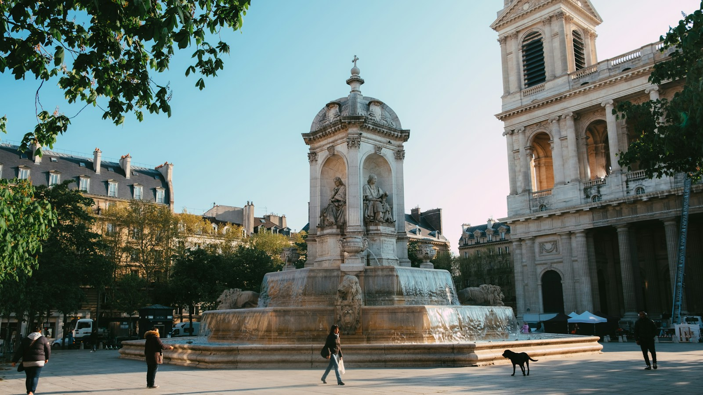
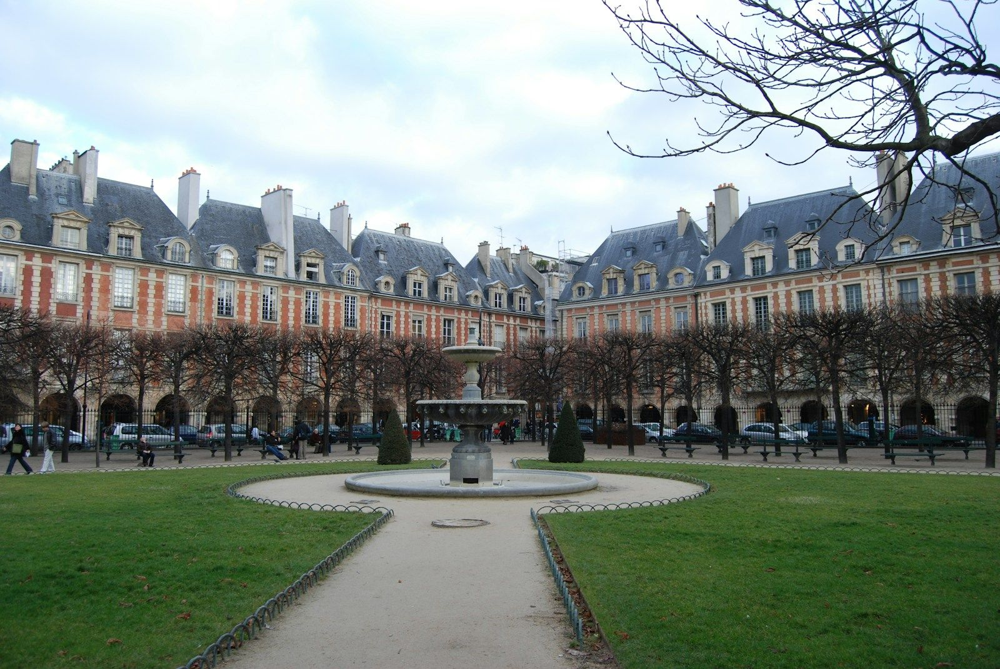

Paris rewards the traveler who picks a neighborhood first. The city is made for walking, and the streets right outside your hotel shape every morning coffee, every evening stroll and every dinner you can walk home from. After [fifteen years working inside luxury hotels](/about/), my advice is simple: decide what kind of Paris you want, choose the quarter, then choose the hotel.

From Charles de Gaulle, the drive to the Place de la Concorde takes roughly 45 to 60 minutes; from Orly, about 30 to 45, depending on traffic. A private transfer is the easiest way to arrive. Here's how four of the city's best hotel neighborhoods compare.

## The Tuileries and Place de la Concorde: For Grand Hotels and Classic Views

Between the Louvre and the Place de la Concorde, the Right Bank around the Tuileries Garden is Paris at its most monumental: palace hotels, the rue de Rivoli, and the Louvre a short walk away.

**Who it suits:** first-timers, honeymooners, museum lovers, and anyone who wants the postcard version of Paris outside the door.

**Hotels to know:** Le Meurice, from Dorchester Collection, sits at 228 rue de Rivoli, opposite the Tuileries Garden and about five minutes on foot from the Louvre. Hôtel de Crillon, A Rosewood Hotel, is on the Place de la Concorde itself, with the Concorde Métro station steps from the door.

**Ask for at check-in:** confirm whether your room faces the garden or the square, or looks onto a courtyard. In these buildings, the view is part of the room category and part of the price.

## The Golden Triangle: For Fashion, Shopping and Polish

Just west, in the 8th arrondissement near the Champs-Élysées and the Grand Palais, the Golden Triangle is surrounded by haute couture boutiques and galleries.

**Who it suits:** shoppers, couples, business travelers, and anyone who wants a discreet, residential feel.

**Hotels to know:** Hôtel San Régis is a 42-room hotel in a mansion built in 1857, a hotel since 1923, and some rooms have Eiffel Tower views. La Réserve Paris Hotel and Spa is a small mansion hotel near the Champs-Élysées with butler service for every room and suite.

## Saint-Germain-des-Prés and the 7th: For the Left Bank

Across the Seine, Saint-Germain-des-Prés is the literary, artistic Left Bank: historic cafés, stylish boutiques and art galleries, with the Musée d'Orsay a walk away in the neighboring 7th.

**Who it suits:** return visitors, food lovers, couples, and anyone who wants to feel like they live in Paris for a week.

**Hotels to know:** Mandarin Oriental Lutetia, at 45 boulevard Raspail, opened in 1910 and is the only palace hotel on the Left Bank. It reopened in 2018 after a full restoration and now includes a spa. J.K. Place Paris, in the 7th, is a small hotel with Italian design, a short walk from the Musée d'Orsay and the Seine.

**Ask for at check-in:** whether your room faces the street or an inner courtyard. Street-facing rooms often have the better view; courtyard rooms are usually the quieter night.

## The Marais: For History, Galleries and Character

The Marais is 17th-century mansions, galleries, museums and boutiques, with the Picasso Museum close by. At its heart is the Place des Vosges, the oldest planned square in Paris.

**Who it suits:** design lovers, gallery-goers, and travelers who want a neighborhood with real life on the street.

**Hotels to know:** Le Pavillon de la Reine & Spa is tucked behind the Place des Vosges in a 17th-century building with an ivy-covered facade and its own spa. Cour des Vosges, from Evok Collection, is a 12-room hotel in a restored 17th-century mansion on the same square.

## When to Go

Spring and fall are the sweet spots: April and May, then September and October, bring softer weather and thinner crowds than summer. In August, many small boutiques, bistros and bakeries close while Parisians leave for their own holidays, although museums and major restaurants stay open. Winter is quieter and more affordable. Watch the Paris Fashion Week calendar: the women's shows in late February and early March, and again in late September and early October, fill the best hotels fast, so book well ahead if your dates overlap.

## What to Ask for at Check-In, From Someone Who Stood Behind the Desk

- **Confirm your view category before you unpack.** Garden, street, courtyard and Eiffel Tower views are priced differently in Paris, and the front desk can fix a mismatch in minutes.
- **Mention the occasion.** Honeymoons and anniversaries get noted on the reservation, and a note is how a small touch happens.
- **Book your important dinners before you fly.** The city's most sought-after tables can fill a month or more ahead, and the concierge can only do so much on the day.
- **Ask the concierge for the neighborhood places they'd go themselves.** That's where the hotel's local knowledge pays off.
- **Request late checkout when you arrive,** not on your last morning.

## How Booking With an Advisor Works Here

When you book through me, you pay the same room rate you'd pay booking direct, and you get partner perks on top. As a Fora advisor, I can attach perks at every hotel named above. Fora's public pages currently list breakfast daily and an upgrade and extended check-in and checkout whenever possible at Hôtel de Crillon, Hôtel San Régis, La Réserve Paris, Mandarin Oriental Lutetia, J.K. Place Paris, Le Pavillon de la Reine and Cour des Vosges, each with a credit: $100 for food and beverage at Hôtel de Crillon, La Réserve and Le Pavillon de la Reine, $100 for the hotel at Lutetia and J.K. Place, $50 to $100 for the hotel at San Régis, and a food and beverage credit at Cour des Vosges. At Le Meurice, they list breakfast daily, a $100 hotel credit and an upgrade whenever possible. Upgrades, early check-in and late checkout are always subject to availability, and perks can change, so I confirm what applies to your dates before you book.

[Hotel-only bookings](/services/#pricing) with me are complimentary. If you want flights handled too, or a full itinerary with restaurants, museums and day trips planned day by day, that's a flat planning fee, listed on my [Services page](/services/#pricing).

## Start Here

Tell me who's going, when, and whether you picture yourself on the Right Bank by the Tuileries or on the Left Bank in Saint-Germain. I'll come back with the right neighborhood, the right hotel and the right room. The first step is a short intake that sets up your traveler profile: [start your trip](https://secure.foratravel.com/intake/wyldwandering/C8ug7ybur3).

---

*Photos: [Calvin Craig](https://unsplash.com/photos/the-eiffel-tower-towering-over-the-city-of-paris-gVvNhmKcXyw) / Unsplash, [Sylvia Zhou](https://unsplash.com/photos/a-large-building-with-a-fountain-in-the-middle-of-it-3v9lpt04byw) / Unsplash, [Caleb Maxwell](https://unsplash.com/photos/people-walking-on-park-with-fountain-in-front-of-white-concrete-building-during-daytime-UUh86rJhSNw) / Unsplash, [Danielle Barnes](https://unsplash.com/photos/b0Lg94AMqmk) / Unsplash*
